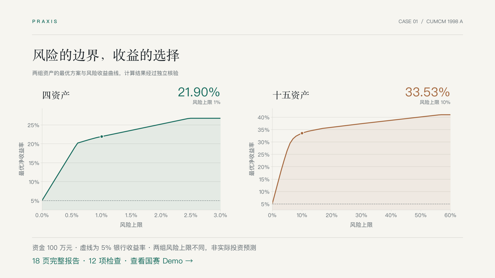
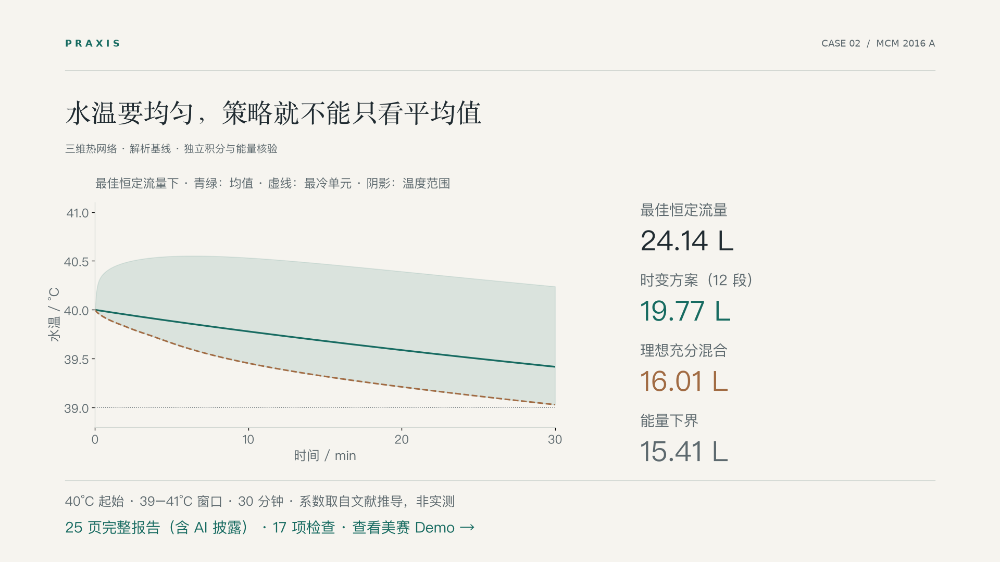
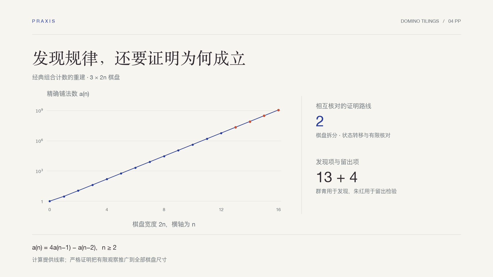
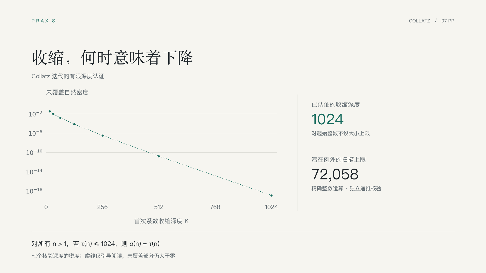

# 案例总览

### 从建模问题到完整作品

竞赛解答、数学证明与决策研究：查看主要结果、评阅意见、完整论文和计算依据。

**简体中文** · [English](README.en.md) · [返回 Praxis](../README.md)

[竞赛建模](#竞赛建模) · [专业数据分析](#专业数据分析) · [数学研究](#数学研究) · [决策分析](#决策分析)

## 竞赛建模

两个完整案例分别研究投资配置与热水控制。每个页面先说明问题和结果，再提供方法、验证、作品评议、论文与计算复现。

<table>
<tr>
<td width="50%" valign="top"></td>
<td width="50%" valign="top"></td>
</tr>
<tr>
<td valign="top"><strong>国赛 · 投资收益与风险</strong> 1998 CUMCM A · 35 页中文报告  最低交易费与预算共同约束投资；给定收益目标后反求最低风险，用原费方案和独立界检查最优性。  <a href="cumcm-1998-a/README.md">查看案例 →</a> · <a href="cumcm-1998-a/deliverables/paper.pdf">论文</a> · <a href="cumcm-1998-a/README.md#计算复现">复现</a></td>
<td valign="top"><strong>美赛 · A Hot Bath</strong> 2016 MCM A · 28 页英文报告  从理想充分混合基线走到三维热网络，解释为什么平均水温足够高，局部仍可能太冷。  <a href="mcm-2016-a/README.md">查看案例 →</a> · <a href="mcm-2016-a/paper.pdf">论文</a> · <a href="mcm-2016-a/README.md#计算复现">复现</a></td>
</tr>
</table>

更多作品见 **[美赛建模论文](https://github.com/WJSGZZ/praxis/blob/main/demos/mcm-studies/README.md)**：沙堡抗侵蚀、大黄蜂报告分流、沿海保险等，每题选一份代表作，按建模问题分类。评阅依据与适用范围见对应说明。

## 专业数据分析

**[重复测量：从数据表到统计结论 →](data-analysis/README.md)** 用十二家原创合成门店的四十八条周记录，串起数据契约、关联基数、按店推断、两项比较的 Holm 校正与独立算术核验。可直接运行，保留原件和坏关联的拒绝记录；合成关联不冒充真实门店或因果效果。

**[服务覆盖与最低资源 →](spatial-analysis/README.md)** 三个合成设施与三个需求点，把公里距离、边界覆盖、容量分配及位置误差接起来。名义费用17与所有允许位置下费用25各有可行分配和独立下界；设施失效时，总容量够用仍留下局部缺口。提供实际科研图、固定输入与复现代码。

**[二值掩码与连通区域测量 →](image-analysis/README.md)** 同一张原创32×40掩码在四／八邻接下有7／6个区域；边界与最小面积规则保留3个区域、68像素。像素面积、边界框和质心由独立小例核查，尺度换算、过滤分母和实际科研图可以复现，连通区域不自动当作真实物体。

## 数学研究

没有标准答案时，计算负责发现线索，证明负责确定结论的范围。这两份笔记展示不同的研究任务：重建经典结果，以及在开放问题中建立有边界的结论。

<table>
<tr>
<td width="50%" valign="top"></td>
<td width="50%" valign="top"></td>
</tr>
<tr>
<td valign="top"><strong>多米诺 · 从规律到证明</strong> 组合计数 · 4 页英文笔记  三种算法核对小例子，保留四项检验猜测，再用构造分解与转移矩阵分别证明递推。  <a href="domino-research/README.md">查看案例 →</a> · <a href="domino-research/deliverables/paper.pdf">论文</a> · <a href="domino-research/README.md#计算复现">复现</a></td>
<td valign="top"><strong>Collatz · 有限核对与严格归约</strong> 开放数学探索 · 7 页英文笔记  首收缩锐包络把无限整数域中的条件命题归约到有限检查，并证明继续扩大同类计算的局限。  <a href="collatz-research/README.md">查看案例 →</a> · <a href="collatz-research/deliverables/paper.pdf">论文</a> · <a href="collatz-research/README.md#计算复现">复现</a></td>
</tr>
</table>

## 决策分析

### 收费站布局与汇合排队

**2017 MCM B · Merge After Toll · 17 页英文报告**

增加收费窗口可能改善通行，也可能加重出口等待。研究将支付兼容、汇合几何与有限排队空间连接起来，解释方案偏好为何反转，并保留反例与独立核验。

**[打开研究归档 →](https://github.com/WJSGZZ/praxis/tree/main/research/merge-after-toll)**

---

竞赛案例采用往年题目，完整交付物见各自页面；研究笔记给出证明范围、文献来源与可复现依据。
