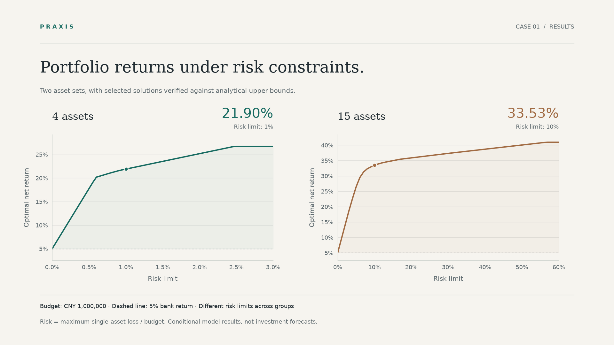

# Investment Return and Risk

**1998 CUMCM Problem A · A portfolio model that accounts for minimum fees and explains when its solution is provably optimal.**

[简体中文](README.md) · [Paper](deliverables/paper.pdf) · [Supporting archive](deliverables/supporting_materials.zip) · [All cases](../README.en.md) · [Praxis](../../README.en.md)

[Results](#results) · [Review](#review) · [Reproduction](#reproduction)



## The modeling problem

A firm can leave its capital in a bank or invest in assets with different returns, possible losses and transaction fees. Small purchases still incur a minimum fee. The supplied four-asset and fifteen-asset datasets therefore require more than simply ranking returns.

Risk here means the **largest possible loss on any single asset**, rather than portfolio variance. The bank pays 5% annually. Principal, fees and the bank balance share one budget; the firm's acceptable risk is not specified.

## Results

The representative calculations use **CNY 1,000,000**, with fees deducted from net return.

| Dataset | Risk limit | Optimal net return | Optimality evidence |
|---|---:|---:|---|
| Four assets | 1% | **21.90%** | Integer optimization, all 81 fee regimes and an analytical bound agree |
| Fifteen assets | 10% | **33.53%** | A feasible allocation attains the analytical bound |

The risk limit is the largest asset-level loss divided by capital. Different limits make these two rows unsuitable for ranking the datasets; the values are conditional optimization results.

With a specified minimum net return, the model instead finds the least risk under the original fees:

| Dataset | Illustrative return target | Minimum risk, rounded |
|---|---:|---:|
| Four assets | 20% | **0.587599%** |
| Fifteen assets | 33% | **9.128131%** |

Six nontrivial targets have feasible original-fee portfolios attaining independently derived rational lower bounds. The bank achieves 5% at zero risk. Targets of 27% and 41% exceed the respective global return maxima and are unreachable. These inputs illustrate the method rather than a real firm's preferences. A CNY 100 example, checked over all 16 supports, shows why minimum fees can prevent the relaxed inverse from being attained.

When preferences are absent, the report retains the frontier. Geometric knees remain examples: a **0.6%** limit with **20.19%** return for four assets, and an **8%** limit with **32.29%** return for fifteen assets. Their shape does not establish an investor's risk attitude.

## Model and argument

1. **Represent fees faithfully.** An unpurchased asset incurs no fee. Once selected, it is charged on the greater of the purchase and threshold amounts; binary variables capture that distinction.
2. **Trace the frontier.** A mixed-integer linear program maximizes net return at each risk limit.
3. **Establish a separate bound.** Removing the minimum fee yields a proportional-fee relaxation solved by ranking gain per unit of budget. A feasible original allocation reaching its bound is globally optimal.
4. **Explain the role of scale.** At the representative limits, **CNY 339 and CNY 2,602** are sufficient capital thresholds for attaining the relaxed bound. They are not necessary thresholds.
5. **Turn a goal into a decision.** Minimize risk subject to the return target, then check the original-fee portfolio against a dual bound. Sufficient capital thresholds are rounded upward to cents; rounding purchases requires another feasibility check.

## Verification and scope

| Question | Finding |
|---|---|
| Is the optimization correct? | Fee-regime enumeration, analytical bounds and independent rational arithmetic agree; 12 baseline checks cover budgets, fees and boundary cases. |
| Can the allocation tolerate execution error? | Under ±5% random purchase errors, roughly nine in ten trials exceed the risk limit. A 5% tighter limit costs about 0.3–0.6 percentage points in the checked cases. |
| Does input uncertainty change the selection? | Under ±10% perturbations to returns, loss rates and fee rates, with minimum-fee thresholds fixed, the selected assets persist in at least 99.5% of trials. Return comparisons first restore budget and risk feasibility. |
| Is a simpler rule adequate? | At CNY 1,000,000, allocation by gain per unit of budget matches the integer optimum in six checked cases. Minimum fees matter more at small budgets. Return-to-risk ranking loses up to 4.3 percentage points. |
| Does another risk definition change the answer? | Treating risk as a standard deviation of independent returns produces different allocations. The paper keeps this comparison explicit. |

Trial proportions describe the stated error scenarios, not real-world investment success rates. Removing selected assets measures their contribution in the checked portfolios. Detailed records are in [reproduce/reference/](reproduce/reference/).

## Review

**Current review: complete task coverage and exact optimality evidence for six return targets; award boundaries remain uncalibrated.**

The argument connects the original fee-inclusive budget to exchange proofs, capital thresholds and dual bounds. Prior checks of eight representative allocations and two thresholds remain archived. The new reviewer independently rebuilt six inverse answers, fee-inclusive portfolios, unreachable targets and the small-budget counterexample from the supplied data.

The inverse now explains how a return requirement determines risk. Actual firm preferences and capital are still unknown. The maximum single-asset loss remains a proxy; error scenarios are not empirically calibrated. A risk buffer alone does not guarantee the target return after execution error.

The current 35-page manuscript was reviewed by an AI outside the author role in a shared workspace. This is non-blind, without human review or award calibration. The earlier 23-page manuscript's prize-range opinion remains historical and is not rebound to this revision. [Version and scope](verification.json)

## Paper and deliverables

| Resource | Contents |
|---|---|
| [The complete 35-page paper](deliverables/paper.pdf) | One abstract page, 14 pages of answers and references, and 20 appendix pages containing all nine programs |
| [Supporting ZIP](deliverables/supporting_materials.zip) | 32 files: calculations, rational certificates, LaTeX sources and two-page AI-use details |
| [Checksums](manifest.json) | File sizes, MD5 and SHA-256 for both deliverables |

Only the PDF and ZIP sit in `deliverables/`. Presentation assets and reproduction records are separate. The manuscript uses the shared [CUMCM template](../../templates/cumcm-paper.tex) and [pinned fonts](../../templates/cumcm-fonts.json).

## Reproduction

From the Praxis repository root:

```bash
uv sync --locked
uv run --locked python demos/cumcm-1998-a/reproduce/run_demo.py
```

This recomputes both datasets, frontiers and baseline checks in `demos/cumcm-1998-a/reproduce/reproduced/`. It refuses to overwrite an existing output directory. Numerical reproduction needs neither LaTeX nor an AI service.

<details>
<summary>Additional verification commands</summary>

```bash
uv run --locked python demos/cumcm-1998-a/reproduce/check_capital_threshold.py
uv run --locked python demos/cumcm-1998-a/reproduce/check_recommendation.py
uv run --locked python demos/cumcm-1998-a/reproduce/check_robustness.py
uv run --locked python demos/cumcm-1998-a/reproduce/check_alternatives.py
uv run --locked python demos/cumcm-1998-a/reproduce/check_return_target.py
uv run --locked python demos/cumcm-1998-a/reproduce/check_target_certificates.py --numeric demos/cumcm-1998-a/reproduce/reference/return-targets.json
```

These cover capital thresholds, knee examples and bounds, error margins, alternative risk interpretations, inverse targets and independent rational certificates. Use `--group four --target 0.20 --budget 1000000` to select a target and budget. New outputs refuse to overwrite an existing result. The supporting ZIP also includes independent reproduction instructions.

</details>

## File structure

```text
deliverables/       Paper PDF and supporting ZIP
reproduce/          Calculations, checks and archived results
assets/             Presentation images
manifest.json       Deliverable checksums
verification.json   Review and acceptance record
```

## Sources and license

Inputs come from page 11 of the organizers' [historical problem collection](https://www.mcm.edu.cn/upload_cn/node/1/SkAh1A7Q6f2dd01e58aa621f920e79f45cd5d255.pdf). Deliverables follow the [2026 format guidance](https://www.mcm.edu.cn/html_cn/node/4cd596519c9eb9fbd866398f6df0caa3.html) and [AI-use policy](https://www.mcm.edu.cn/html_cn/node/fef94648f2836ab6cc81586f4c38512b.html).

This historical-problem solution was produced for Praxis. Original code, manuscript, documentation and figures use the repository's [MIT License](../../LICENSE); problem inputs and third-party tools retain their stated origins and rights.
