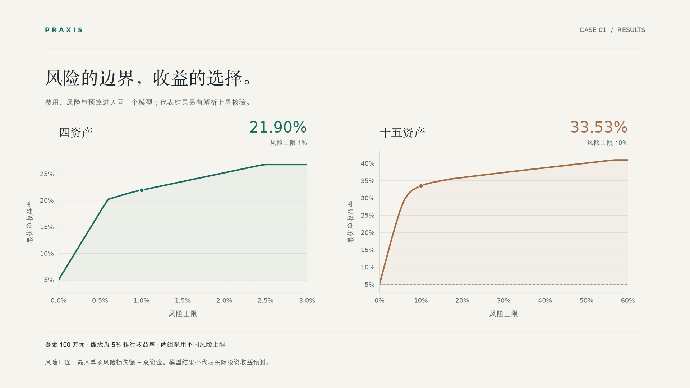

# 国赛案例：投资收益与风险

**1998 CUMCM A · 最低交易费如何影响投资组合，以及怎样证明推荐方案的最优性。**

[English](README.en.md) · [完整论文](deliverables/paper.pdf) · [支撑材料](deliverables/supporting_materials.zip) · [案例总览](../README.md) · [Praxis](../../README.md)

[主要结果](#主要结果) · [作品评议](#作品评议) · [计算复现](#计算复现)



## 问题与难点

一家公司可以把资金存入银行，也可以买入不同资产。资产收益越高，可能承担的损失越大；买入金额很小时，交易费仍按最低门槛收取。题目给出 4 种和 15 种资产的两组数据，要求分析收益与风险的折中。

本题的风险是**单项资产可能损失金额的最大值**，银行年利率为 5%。模型同时计入买入本金、手续费和银行余额。难点是最低费用使“小额买入”未必划算，而题目没有规定公司愿意承担多少风险。

## 主要结果

总资金取 **100 万元**，净收益均已扣除交易费。

| 资产组 | 风险上限 | 最优净收益率 | 最优性的依据 |
|---|---:|---:|---|
| 4 种资产 | 1% | **21.90%** | 整数规划、81 种费用状态穷举与解析上界一致 |
| 15 种资产 | 10% | **33.53%** | 可行方案达到解析上界 |

风险上限按“最大单项损失 ÷ 总资金”计算。两行采用不同上限，不能据此判断哪组资产更好；这些是题设参数下的优化结果。

公司给出最低净收益目标后，模型可以反求原手续费条件下的最低风险，而不必从曲线形状猜偏好：

| 资产组 | 示例目标净收益率 | 最低风险（近似） |
|---|---:|---:|
| 4 种资产 | 20% | **0.587599%** |
| 15 种资产 | 33% | **9.128131%** |

六个非平凡示例均有原费用可行方案与独立有理数下界相等的最优性证书。银行的 5% 收益对应零风险；27% 与 41% 分别超过两组全风险范围的最高净收益，因此不可达。目标是说明方法的输入，不代表真实公司要求。资金小时最低费用会使松弛界不紧，论文保留 100 元、16 个支持集的完整反例。

缺少偏好时保留整条方案族。几何拐点仍展示两种折中：4 种资产在 **0.6%** 上限下净收益 **20.19%**，15 种资产在 **8%** 上限下为 **32.29%**；它们不能独自代表公司的风险态度。

## 建模方法

1. **准确表示费用。** 不买资产时费用为零；买入后按实际金额与门槛中的较大者计费，用二元变量表示是否购买。
2. **求出收益—风险关系。** 在给定风险上限下，用混合整数线性规划最大化净收益，再改变上限得到整条曲线。
3. **给出独立最优性依据。** 去掉最低费用得到较宽松的问题，按单位预算增益排序可求解析上界。原问题的可行方案达到上界时，即可证明全局最优。
4. **解释资金规模的作用。** 代表风险上限下，资金达到 **339 元、2602 元** 是原问题取得相应松弛上界的充分条件；这不是必要条件。
5. **从目标形成决策。** 加入最低净收益约束并最小化风险，独立验证原费方案与对偶下界；充分资金门槛向上取分，实际购买额取整后须再检查。

## 验证与适用范围

| 检查的问题 | 得到的结论 |
|---|---|
| 优化器是否算对 | 4 资产费用分区穷举、解析上界及独立有理数核算互证；12 项基础检查覆盖预算、费用和边界。 |
| 方案能否按原金额执行 | 每项投资额有 ±5% 随机操作误差时，约九成试验超出风险上限。收紧上限 5% 的情景中，净收益少约 0.3–0.6 个百分点。 |
| 参数变化是否改变选择 | 收益率、损失率和费率作 ±10% 扰动、最低费用门槛固定时，所选资产至少在 99.5% 的试验中保持；比较收益前先调整方案以满足新预算与风险约束。 |
| 简单规则是否足够 | 100 万元下，按单位预算增益分配在六个检查情形中与整数最优解一致；最低门槛在小资金下才更重要。按收益风险比排序最多差 4.3 个百分点。 |
| 风险定义是否影响答案 | 将风险另读为独立收益的标准差，会得到不同的配置和收益；论文保留该对照，提示先确认风险含义。 |

上述随机试验检验的是声明的误差情景，其比例不是实际投资成功率。逐项剔除的比较只说明所检验组合中选中资产的作用。计算与检查记录见 [reproduce/reference/](reproduce/reference/)。

## 作品评议

**当前整稿审阅：任务覆盖完整，六个目标逆解有精确最优性证据；奖项档次未校准。**

论文把费用、资金和收益统一到原问题，再用交换论证、资金门槛和对偶界解释何时可以证明全局最优。已有八个代表配置和两个资金临界值的核算记录保留；新审阅另从原题数据独立核算六个目标、原费配置、不可达边界和小资金反例。

逆问题改善了“目标如何决定风险”的连接。真实公司目标和资金仍未知，最大单项损失是题意下的代理指标，误差情景未由现实数据标定；预留风险余量也不自动保证操作误差后的收益目标。

这是当前 35 页稿的作者外 AI 审阅，共享工作区、非盲，没有真人或奖项校准。旧 23 页稿的一等奖边缘参考判断保留为历史版本，未自动绑定新稿。[版本与检查范围](verification.json)

## 论文与交付文件

| 文件 | 内容 |
|---|---|
| [完整 35 页中文论文](deliverables/paper.pdf) | 摘要 1 页、解答与参考等 14 页、附录 20 页；含九个完整源程序 |
| [支撑材料 ZIP](deliverables/supporting_materials.zip) | 32 个文件，含计算代码、有理证书、LaTeX 源及 2 页 AI 工具使用详情 |
| [文件校验清单](manifest.json) | 两份交付文件的字节数、MD5 和 SHA-256 |

`deliverables/` 只放论文与支撑包。展示图、复现记录和案例说明在提交目录之外。论文采用共享国赛模板和固定字体；排版配置见 [模板](../../templates/cumcm-paper.tex)与[字体清单](../../templates/cumcm-fonts.json)。

## 计算复现

在 Praxis 仓库根目录执行：

```bash
uv sync --locked
uv run --locked python demos/cumcm-1998-a/reproduce/run_demo.py
```

该入口重算两组资产方案、风险收益曲线及基础检查，写入 `demos/cumcm-1998-a/reproduce/reproduced/`；目录已存在时拒绝覆盖。数值复现无需 LaTeX 或 AI 服务。

<details>
<summary>专项验证命令</summary>

```bash
uv run --locked python demos/cumcm-1998-a/reproduce/check_capital_threshold.py
uv run --locked python demos/cumcm-1998-a/reproduce/check_recommendation.py
uv run --locked python demos/cumcm-1998-a/reproduce/check_robustness.py
uv run --locked python demos/cumcm-1998-a/reproduce/check_alternatives.py
uv run --locked python demos/cumcm-1998-a/reproduce/check_return_target.py
uv run --locked python demos/cumcm-1998-a/reproduce/check_target_certificates.py --numeric demos/cumcm-1998-a/reproduce/reference/return-targets.json
```

分别检查资金门槛、拐点与上界、误差与余量、替代规则与风险口径、目标逆解及独立有理证书。逆解可用 `--group four --target 0.20 --budget 1000000` 指定目标与资金。新输出拒绝覆盖同名结果。也可独立解压支撑包，按包内说明复现论文计算。

</details>

## 文件结构

```text
deliverables/       论文 PDF 与支撑材料 ZIP
reproduce/          计算入口、专项验证、归档结果
assets/             案例展示图片
manifest.json       交付文件校验清单
verification.json   评阅与验收记录
```

## 资料与许可

题目与参数来自[官方历史赛题汇编](https://www.mcm.edu.cn/upload_cn/node/1/SkAh1A7Q6f2dd01e58aa621f920e79f45cd5d255.pdf)第 11 页；论文和支撑文件按[2026 论文格式规范](https://www.mcm.edu.cn/html_cn/node/4cd596519c9eb9fbd866398f6df0caa3.html)及[AI 工具使用规定](https://www.mcm.edu.cn/html_cn/node/fef94648f2836ab6cc81586f4c38512b.html)组织。

本案例是本项目制作的往年题解答。原创代码、论文、说明与图表采用仓库 [MIT 许可](../../LICENSE)；题目参数及第三方工具保留来源和各自权利。
