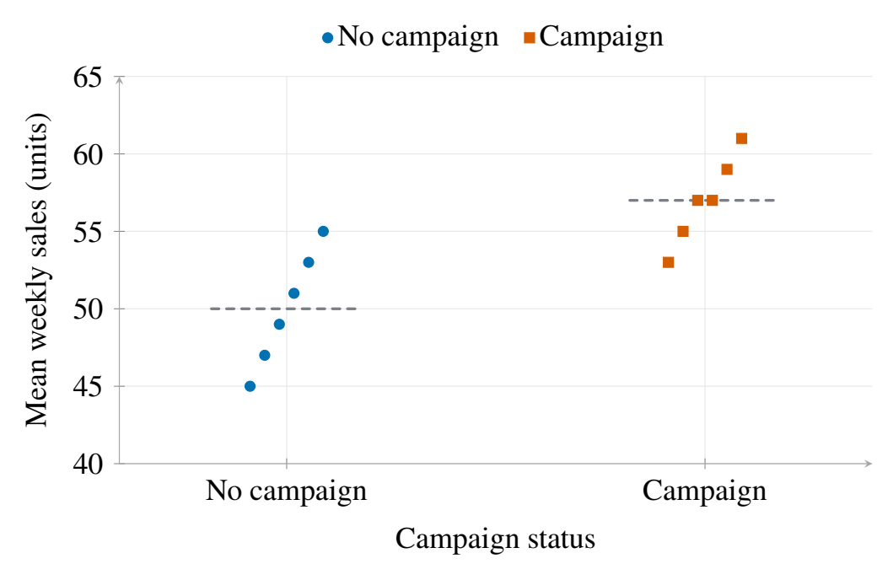

# 重复测量：从数据表到统计结论

**简体中文** · [English](README.en.md) · [案例总览](../README.md)

一家连锁店按周记录销售。每店四周的数据应怎样关联门店档案、比较活动组与非活动组，又怎样避免把重复记录当成独立门店？这个演练用完全原创的合成数据，把数据契约、关联检查、聚类推断和多重比较接在同一个可复现任务里。



*图 1. 门店间的销售差异。* 每点是一家合成门店的四周均值，每组六店；灰色短线是组均值。横向偏移仅用于分开相同值，没有数量含义。图由实际汇总数组生成，原始四十八条周记录仍保留。也可[查看矢量图](assets/store-means.pdf)。

## 可以回答什么

固定模型同时包含活动状态和中心化周数，按门店计算 CRV1 聚类协方差，区间使用十一自由度的 t 参考分布：

| 条件关联 | 估计 | 95% 区间 | 单位 |
|---|---:|---:|---|
| 活动组相对非活动组 | 7.00 | 2.89–11.11 | 销售单位 |
| 每周趋势 | 2.00 | 1.41–2.59 | 销售单位／周 |

这说明构造数据中的条件关联；不能据此推断真实活动的因果效果。十二个簇仍很少，有限样本修正和 t 参考分布不保证实际区间覆盖。合成构造、算术核验与真实抽样设计是不同的证据。

## 数据、方法与核验

观察单位是店周，独立单位声明为门店，四十八行对应十二店。脚本在构造数据前保存两项比较及完整的 Holm 校正族。档案表必须一店一行；合法 `many_to_one` 关联保留全部观察，故意复制一个档案键会被 Pandas 的真实基数检查拒绝。

模型沿用 Statsmodels OLS，由 `ols_report(covariance="cluster", groups=...)` 请求按店推断；`adjust_pvalues` 校正完整的两项比较。验证器直接计算各店残差的 score 和夹心矩阵，另外用有理数核对活动系数的方差为 **94/27**；三个系数的已知答案是 **50、7、2**。Holm 两项公式也直接核对。输入 CSV 的前后哈希必须一致。

这些检查验证这个确定性例子的计算、错误关联拒绝和原件保全，未验证真实门店、因果识别或重复抽样的区间覆盖。完整方法和输入条件见[专业统计](../../references/statistical-analysis.md)及[数据分析](../../references/data-analysis.md)。

## 复现

在源码目录或已准备依赖的插件核心目录运行，输出路径须尚不存在：

```bash
uv run --locked python -m examples.data_analysis_demo --output /path/to/new-store-run
```

输出包含原始合成 CSV、事前分析计划、数据契约与审计、关联及拒绝记录、回归区间、比较族、独立算术核验和 `report.json`。脚本只在指定的新目录生成文件，不下载数据，不上传。

需要重建图时，另用已固定的 Tectonic 环境，保持新输出目录：

```bash
uv run --locked python demos/data-analysis/build_figure.py --run /path/to/new-store-run --output /path/to/new-store-figure
```

图源再次从原始合成 CSV 核对店均值，保存每条系列的实际数组、颜色、标记和图例，并输出矢量 PDF 与 PNG。最后仍需查看图；字段清单和哈希不代替视觉核验。公开图与复现来源的选定记录见 [demo.json](demo.json)。
