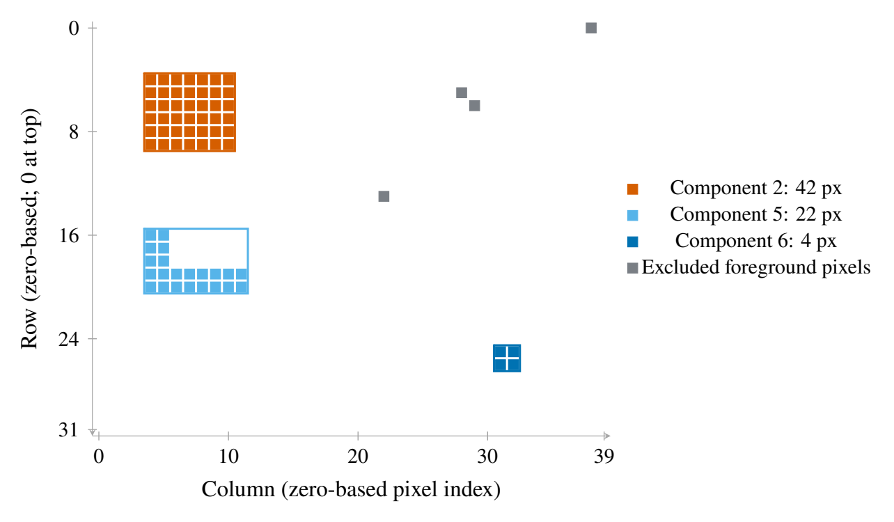

# 从二值掩码到连通区域测量

这个小例子说明同一张二值掩码怎样因邻接定义而得到不同组件数，以及面积过滤、边界排除和返回上限各自改变什么。掩码由脚本在本地构造，只有矩形、L形、对角相邻点、边缘点和小块；没有真实显微图、粒子或生物样本。



*图 1. 保留组件与排除像素。* 方框表示保留组件的像素外沿，颜色区分组件；灰色像素因触边或尺寸不足被排除。坐标为列／行的零基像素索引，行 0 位于图上方。也可查看[矢量 PDF](assets/components.pdf)。

## 固定结果

掩码大小为 **32×40**，前景共 **72 像素**。4 邻接下有 **7 个组件**，8 邻接下有 **6 个**：两个只在角上接触的像素在 4 邻接下分开，在 8 邻接下合并。这个差异来自定义，不是图像内容变化。

采用 8 邻接、先排除触边组件、再要求至少 3 像素后，保留 **3 个组件、68 像素**。另有 1 个触边组件和 2 个尺寸不足的组件被排除。以调用方声明的像素宽高 `[0.2, 0.3] mm` 计算，前景总面积为 **4.32 mm²**，过滤后为 **4.08 mm²**。此数字只演示单位换算；工具不会验证标定。

输出的像素质心按像素中心索引 `[row, column]` 表示；外接框为半开区间 `[row_min, column_min, row_max, column_max]`。物理质心则从图像左上角像素边界起算，含半像素中心偏移。

## 独立核对

演示脚本用独立的队列式 BFS 重算 4／8 邻接下的组件，再直接从像素列表求面积、外接框和质心。矩形面积是 `6×7=42`，L 形由 `10+12=22` 个像素组成。它还核对 72 个前景像素守恒、过滤优先顺序和面积合计；没有把 SciPy 输出当成期望答案。固定结果和核对范围见 [results.json](results.json) 与 [demo.json](demo.json)。

这些检查只确认固定合成掩码上的实现和算术，不验证图像分割质量、真实空间标定、现实对象计数或总体推断。

## 复现

从源码目录运行，每次选择一个不存在的新输出目录：

```bash
uv run --locked python -m examples.image_analysis_demo --output /path/to/new-mask-run
uv run --locked python demos/image-analysis/build_figure.py --run /path/to/new-mask-run --output /path/to/new-figure
```

图源采用共享 `scripts.texplot` pgfplots 颜色和排版组件，保留 TeX、PDF、PNG 与图数据。交付前要看最终 PNG 的实际尺寸和坐标方向；生成收据不代替目视检查。

## 用图像数据开展正式分析

真实图像测量先固定原图、来源、采集条件和 ROI，并用同一成像设置下可追溯标尺校准像素尺寸。阈值、预处理、边界和连通规则按测量目标确定，分割误差用独立参考或适合的人工标注核验。若还涉及监督识别或根据数据调参，应先按标本、个体、采集会话或批次等来源家族划分训练／验证／测试，再在训练部分增强；相关裁切和增强图留在同一划分。单纯测量给定掩码无需虚构这些训练阶段。

`binary_components` 仅接受已形成的二维二值掩码。它不读图像、不选 ROI、不阈值分割，也不判断组件是哪个物种、材质或对象。需要分割时，应按成像模态选有维护的图像处理库，并报告其参数选择和独立验证；不要仅凭连通域数声称真实颗粒或生物丰度。完整条件见[图像分析方法](../../references/image-analysis.md)。
