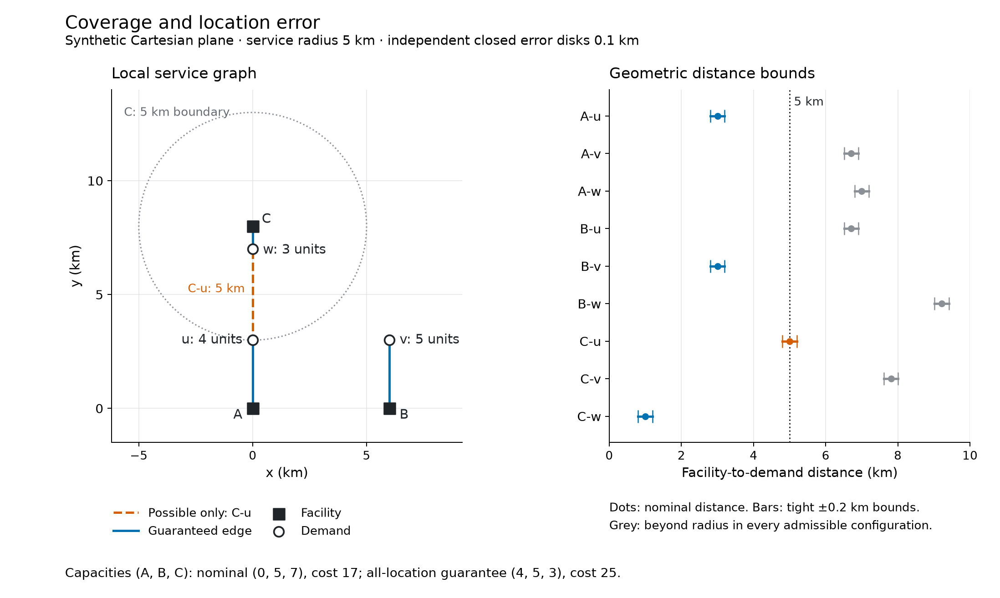

# 服务覆盖与最低资源

**简体中文** · [English](README.en.md) · [案例总览](../README.md)

三个设施要满足三个地点的需求。容量总和够用，是否就能服务全部地点？某个分配方案用到了四单位 A 容量，是否说明 A 至少必须有四单位？这个原创合成案例把距离、覆盖边、最低费用和位置误差放在同一个小任务中，分别给出可行方案与必要条件。



*图 1. 覆盖与位置误差。* 左图是以公里为单位的等比例局部笛卡尔平面；方块是设施，圆点是需求。蓝边在所有允许的位置误差下都可用，橙色虚线 C–u 在名义位置恰为五公里，误差后可超过半径。灰圆是 C 的名义五公里边界。右图保留全部九条距离，点为名义值，横线为几何上下界，不是置信区间。C 在 **(0,8)**，w 在 **(0,7)**，是不同位置。也可[查看矢量图](assets/coverage.pdf)。

## 固定输入与名义结果

坐标明确声明为本地合成笛卡尔平面，单位为 km，不代表真实城市、道路、出行时间或河道。距离不大于 **5 km** 才能直接服务，等号包含在内；需求可以拆分，安装容量是非负连续量，每个设施最多八单位。

| 设施 | 坐标（km） | 每单位容量费用 |
|---|---|---:|
| A | (0,0) | 3 |
| B | (6,0) | 2 |
| C | (0,8) | 1 |

需求 u、v、w 分别位于 **(0,3)、(6,3)、(0,7)**，数量为 **4、5、3**。设施到需求的名义距离如下，粗体项可服务：

| 距离（km） | u | v | w |
|---|---:|---:|---:|
| A | **3** | √45 ≈ 6.7082 | 7 |
| B | √45 ≈ 6.7082 | **3** | √85 ≈ 9.2195 |
| C | **5** | √61 ≈ 7.8102 | **1** |

模型最小化 `3a + 2b + c`，只在允许的边上分配服务，每个需求必须满足，设施分配量不能超过其安装容量。SciPy 计算欧氏距离，既有 `solve_lp` 调用 HiGHS 求解容量与服务流。

| 位置条件 | 最低费用 | 容量 (A,B,C) | 一个达到下界的分配 |
|---|---:|---|---|
| 名义位置 | **17** | **(0,5,7)** | B→v=5，C→u=4，C→w=3 |
| 所有允许误差下均保证服务 | **25** | **(4,5,3)** | A→u=4，B→v=5，C→w=3 |

## 可行方案不能替代必要条件

名义位置下，完整可行域为 `0≤a,b,c≤8`，并且 **b≥5、c≥3、a+c≥7**。v 只能由 B 服务，w 只能由 C 服务；u、w 合计七单位只能使用 A 和 C。这些条件也充分：先给 v 五单位、w 三单位，再用 A 与 C 的剩余容量分配 u 的四单位。

因此 `(4,5,3)` 是可行方案，不能由它推出名义位置一定需要 `a≥4`；反例 `(0,5,7)` 仍满足全部需求。三个坐标各自可达到的最小值是 `(0,5,3)`，但把这些下界拼起来并不可行，因为 `a+c=3<7`。最优性也有独立下界：`b≥5` 与 `a+c≥7` 推出 `3a+2b+c≥17+2a≥17`，而 `(0,5,7)` 达到 17。

## 误差与设施失效

每个设施和需求位置可以独立移动于半径 **0.1 km 的闭圆盘**。名义距离 d 的紧界为 `[max(0,d−0.2), d+0.2]`。A–u、B–v、C–w 必然可用；C–u 的范围为 **[4.8,5.2] km**，只是可能可用；其余五条边在误差下仍不可用。这里没有给位置误差指定概率分布。

容量 `(4,5,3)` 只使用三条必然边，固定分配就能保证所有位置情景。把 C 移到 **(0,8.1)**、u 移到 **(0,2.9)**，其余位置不变，是合法情景，C–u 距离变为 **5.2 km**；此时只能由 A、B、C 分别承担 4、5、3，所以费用至少 25。这个具体反例证明本例即使允许事后重新分配，稳健最优费用仍为 25。一般问题中，各条“可能边”不一定能同时出现，使用必然边得到的保守方案也不自动具有稳健最优性。

B 失效后，v 没有任何可达的活动设施。即便假设把 B 原有五单位容量转给 C，使活动容量为 **(4,0,8)**、总量仍是 **12**，最多也只能服务 u 与 w 的 **7** 单位，v 的 **5** 单位仍无法满足。总量条件不能代替局部可达性条件。

如果给出的只是未标明坐标系的经纬度表，需要先核实坐标顺序、角度单位、CRS／基准及适用的投影或测地距离方法。当前脚本会拒绝把未知角度坐标当成公里；未核实前，不能给出五公里覆盖边或据此推荐资源。方法边界见[空间分析](../../references/spatial-analysis.md)。

## 复现与核验

在源码目录运行，输出路径必须尚不存在：

```bash
uv run --locked python -m examples.spatial_analysis_demo --output /path/to/new-spatial-run
uv run --locked python demos/spatial-analysis/build_figure.py --run /path/to/new-spatial-run --output /path/to/new-spatial-figure
```

执行源内保存固定输入；可选 `--input /path/to/fixed-fixture.json` 接收同一规格的原始 JSON，逐字节保留并检查前后 SHA-256。输出包含九条边的审计、实际 LP 变量与矩阵、两种容量及分配、必要性审查、位置反例、B 失效结果、未知 CRS 拒绝记录和 `report.json`，不修改源码目录。

作者进程中的独立算术用整数平方距离、精确有理数阈值、全部七个非空需求子集的容量割、分配守恒和费用解析下界核对求解器；B 失效另有空邻域的独立上界。图源再次核对原始坐标与全部数组，从真实 artist 记录颜色、线型、标签和图例，导出 PNG 与嵌入字体的矢量 PDF，成品仍须实际查看。选定记录见 [demo.json](demo.json)。这些证据只认证这个固定合成例子的计算与表达，不认证真实 GIS、盲测隔离、因果收益或竞赛奖项。
